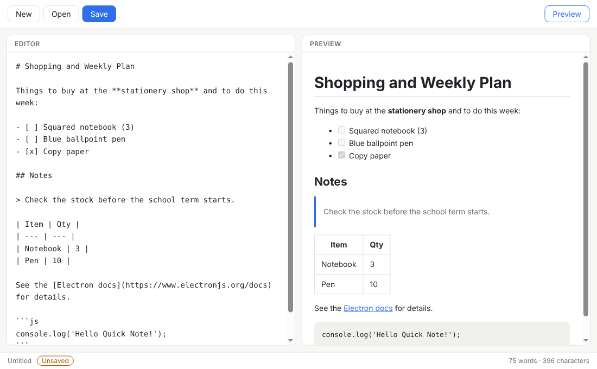

# Chapter 9 — Quick Note

A simple notepad with a Markdown preview. This is the book's first real-world project; it brings together what we learned in Part I (window, preload, IPC, security, menus, file dialogs) in one app.



## Running

```bash
npm install
npm start
```

Tests (run with plain Node.js, without opening Electron):

```bash
npm test
```

## Features

- Open, save and save as text and Markdown files (`.md`, `.txt`)
- Live Markdown preview in a pane you can show or hide
- Unsaved changes warning (on new, open and when closing the window)
- "Unsaved" mark in the window title and the status bar
- Word and character counter
- Light and dark theme (follows the operating system setting)
- Keyboard shortcuts: `Ctrl+N`, `Ctrl+O`, `Ctrl+S`, `Ctrl+Shift+S`, `Ctrl+E` (`Cmd` on macOS)

## Files

| File | Process | Job |
| --- | --- | --- |
| `src/main.js` | Main | Window, menu, file dialogs, disk reads/writes, IPC channels |
| `src/preload.cjs` | Preload | The `window.quickNote` bridge (`contextBridge`) |
| `src/markdown.js` | Main | Turns Markdown into safe HTML (`marked`) |
| `src/document.js` | Main | Window title and file name helpers |
| `src/renderer/` | Renderer | User interface: `index.html`, `style.css`, `renderer.js` |
| `test/` | — | Tests written with `node:test` |

## IPC channels

| Channel | Direction | Type |
| --- | --- | --- |
| `file:new`, `file:open`, `file:save`, `file:save-as` | renderer → main | `invoke` / `handle` |
| `markdown:render` | renderer → main | `invoke` / `handle` |
| `dialog:confirm-unsaved` | renderer → main | `invoke` / `handle` |
| `document:set-dirty`, `window:close` | renderer → main | `send` / `on` |
| `menu:command`, `app:close-requested` | main → renderer | `webContents.send` |

## Security notes

- `contextIsolation` and `sandbox` on, `nodeIntegration` off (Chapter 6).
- Every IPC message is checked to come from our own page (`isTrustedSender`).
- The file path is kept in the main process; the renderer cannot say "write to this path".
- Raw HTML in a note is not executed; only `http(s)`, `mailto` and `#` links are clickable.
- The Content Security Policy (CSP) blocks inline scripts.
- The window cannot navigate to another site; links open in the default browser.

Target version: Electron 45.
