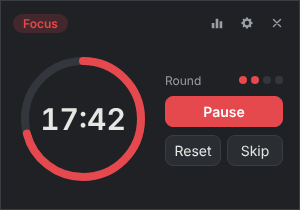

# Chapter 10 — Focus Timer

A Pomodoro timer that lives in the system tray. It announces focus and break times with notifications and keeps running while its window is closed.



## Running

```bash
npm install
npm start
```

Tests (they run with plain Node.js, without opening Electron):

```bash
npm test
```

## Features

- Focus, short break and long break phases; the number of focus sessions before a long break is configurable
- System tray icon (red during focus, green during breaks) and tray menu
- A desktop notification when a phase ends; clicking it starts the next phase
- Global keyboard shortcut: `Ctrl+Alt+P` (`Cmd+Alt+P` on macOS) starts/pauses from anywhere
- A frameless, draggable mini window that can stay on top
- Settings and daily statistics in JSON files (the `userData` folder)
- A daily summary with the focus minutes of the last 7 days
- Start at login (packaged app only)
- Single instance lock: opening the app a second time brings the existing window forward
- Light and dark theme (follows the operating system setting)

## Files

| File | Process | Role |
| --- | --- | --- |
| `src/main.js` | Main | Tray, notifications, shortcut, windows, IPC, single instance lock |
| `src/timer.js` | Main | Timer logic (`FocusTimer`), independent of Electron |
| `src/settings.js` | Main | Default settings and validation |
| `src/stats.js` | Main | Daily focus statistics |
| `src/store.js` | Main | Reading/writing JSON files |
| `src/labels.js` | Main | Tray menu and notification text |
| `src/preload.cjs` | Preload | The `window.focusTimer` bridge |
| `src/renderer/` | Renderer | Mini timer, settings and daily summary pages |
| `assets/` | — | Tray and app icons |
| `test/` | — | Tests written with `node:test` |

## IPC channels

| Channel | Direction | Type |
| --- | --- | --- |
| `timer:get-state`, `settings:get`, `settings:save`, `stats:get` | renderer → main | `invoke` / `handle` |
| `timer:command` (`toggle`, `reset`, `skip`), `window:open`, `window:close` | renderer → main | `send` / `on` |
| `timer:state`, `stats:changed` | main → renderer | `webContents.send` |

## Notes

- The timer runs in the main process; the window only shows its state.
- The remaining time is always calculated from the end time, so it stays correct even if `setInterval` is late.
- Settings are validated in the main process; values from the renderer are not trusted.
- On Windows the settings live in `%APPDATA%\Focus Timer\settings.json`.

Target version: Electron 45.
