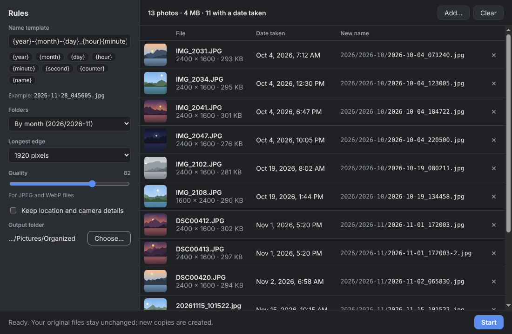

# Chapter 11 — Batch Photos

A tool that renames dropped photos by the date they were taken, resizes them and sorts them into folders. The heavy work runs in the background, in a separate process (`utilityProcess`); the window never freezes.



## Running

```bash
npm install
npm start
```

To try it, drag the `samples/` folder onto the window. Tests (run with plain Node.js, without opening Electron):

```bash
npm test
```

## Features

- Add files and folders by drag and drop (subfolders included) or with the "Choose files" dialog
- Reads the date taken from EXIF; without EXIF, the file's modification date
- Name template: `{year}-{month}-{day}_{hour}{minute}{second}`, `{counter}`, `{name}`
- Sorts into folders by year or by month (`2026/2026-11/`)
- Shrinks the longest edge, JPEG/WebP quality, rotates photos taken with an upright phone
- Removes location and camera details (default) or keeps them
- Preview list: thumbnail, date taken and new name
- Progress bar (in the window and on the taskbar), cancel button, result summary
- Original files are never touched; a new copy is always created and existing files are never overwritten

## Files

| File | Process | Job |
| --- | --- | --- |
| `src/main.js` | Main | Window, dialogs, IPC, starting the worker, taskbar progress |
| `src/worker.js` | Worker (`utilityProcess`) | Scanning (EXIF, thumbnails) and processing photos (`sharp`) |
| `src/files.js` | Worker | Scanning folders, finding a free file name |
| `src/shared/plan.js` | Main + renderer | Name template, folders, clashing names |
| `src/shared/labels.js` | Main + renderer | Text and template words |
| `src/preload.cjs` | Preload | The `window.photoTool` bridge |
| `src/renderer/` | Renderer | User interface |
| `samples/` | — | Sample photos to try |
| `test/` | — | Tests written with `node:test` |

## npm packages used

- [`sharp`](https://sharp.pixelplumbing.com/): resizing, rotating and saving images
- [`exifr`](https://github.com/MikeKovarik/exifr): reading the date taken from EXIF

`sharp` comes with prebuilt files for each operating system. When packaging, these files must stay outside the ASAR archive; the `asar.unpack` setting in `package.json` does that.

Target version: Electron 45.
