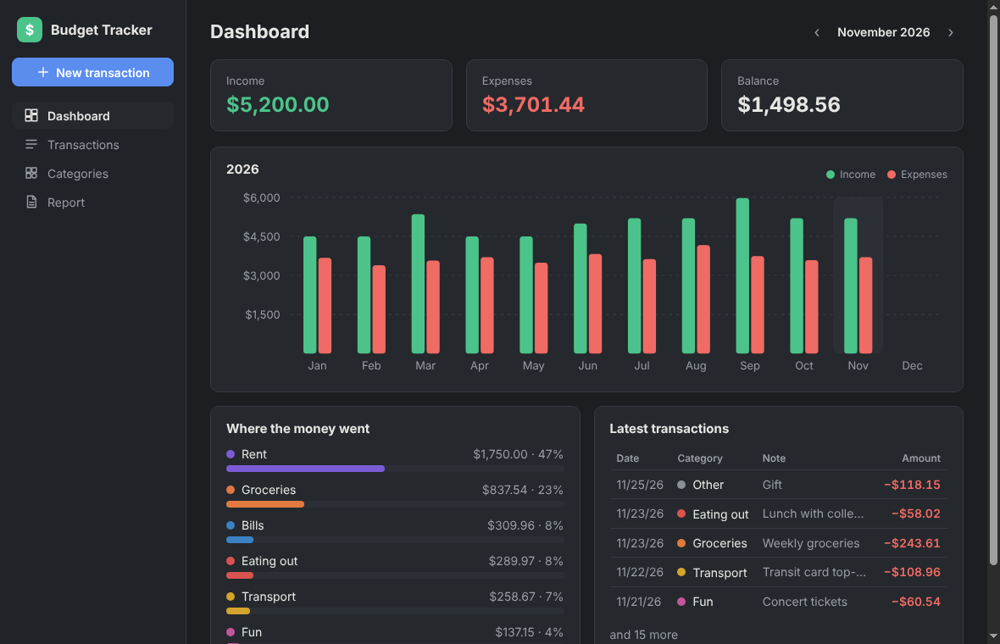

# Chapter 12 — Budget Tracker

A budget app that records income and expenses by category, shows a monthly summary and chart, and exports PDF reports and CSV files. It is the book's first project written with React: the UI is Vite + React, and the data lives in a local SQLite database.



## Running

```bash
npm install
npm start
```

To try it, choose **Transactions > Import CSV** and pick `samples/sample-transactions.csv` (January to November 2026, 236 transactions).

Tests run with Vitest, without starting Electron. The `node:sqlite` module needs Node.js 22.13 or newer:

```bash
npm test
```

## Features

- Add, edit and delete income and expenses (with a confirmation before deleting)
- Dashboard: the month's income, expenses and balance; a bar chart for the 12 months of the year; how expenses split across categories
- Transaction list: filter by month, type and category, search in notes
- Add, rename and recolor categories; a category with transactions cannot be deleted
- Monthly report preview and saving it as a PDF (`printToPDF`)
- CSV export and import (Excel's English format: `,` separator, `1250.50` amounts)
- Migrations: the database version is tracked with `PRAGMA user_version`
- Amounts are stored as whole numbers of cents, so there are no rounding errors
- Light and dark themes

## Files

| File | Process | Job |
| --- | --- | --- |
| `src/main/main.js` | Main | Startup: database, IPC, window |
| `src/main/window.js` | Main | Window settings, loading the page |
| `src/main/database.js` | Main | Opening the database, migrations |
| `src/main/budget-store.js` | Main | All SQL queries and validation |
| `src/main/ipc.js` | Main | IPC channels, CSV file work |
| `src/main/report.js` | Main | PDF report in a hidden window |
| `src/preload.js` | Preload | The `window.budget` bridge |
| `src/shared/` | Main + renderer | Money and date helpers, CSV, texts |
| `src/renderer/` | Renderer | The React UI (`App.jsx`, `pages/`, `components/`) |
| `forge.config.mjs`, `vite.*.config.mjs` | — | Electron Forge and Vite settings |
| `samples/` | — | A sample CSV to try |
| `test/` | — | Vitest tests |

## npm packages used

- [`react`](https://react.dev/), `react-dom`: the UI
- [`vite`](https://vite.dev/), [`@vitejs/plugin-react`](https://github.com/vitejs/vite-plugin-react), [`@electron-forge/plugin-vite`](https://www.electronforge.io/config/plugins/vite): building
- [`vitest`](https://vitest.dev/): tests

There is no extra package for the database: SQLite is used through the `node:sqlite` module that comes with the Node.js inside Electron 45.
