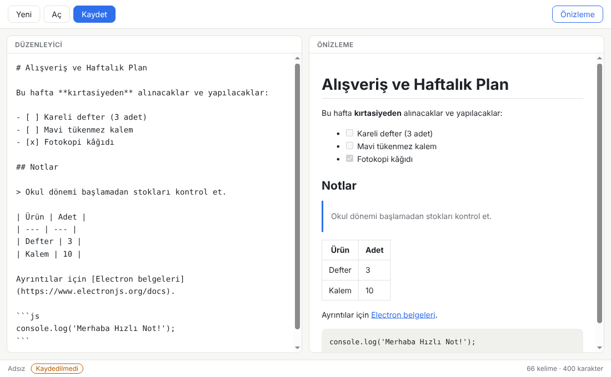

# Bölüm 9 — Hızlı Not

Markdown önizlemeli, sade bir not defteri. Kitabın ilk gerçek hayat projesi; Kısım I'de öğrendiklerimizi (pencere, preload, IPC, güvenlik, menü, dosya diyalogları) tek uygulamada birleştirir.



## Çalıştırma

```bash
npm install
npm start
```

Testler (Electron açılmadan, düz Node.js ile çalışır):

```bash
npm test
```

## Özellikler

- Metin ve Markdown dosyası açma, kaydetme, farklı kaydetme (`.md`, `.txt`)
- Canlı Markdown önizleme, açılıp kapatılabilir panel
- Kaydedilmemiş değişiklik uyarısı (yeni, aç ve pencereyi kapatırken)
- Pencere başlığında ve durum çubuğunda "kaydedilmedi" işareti
- Kelime ve karakter sayacı
- Açık ve koyu tema (işletim sisteminin ayarını izler)
- Klavye kısayolları: `Ctrl+N`, `Ctrl+O`, `Ctrl+S`, `Ctrl+Shift+S`, `Ctrl+E` (macOS'ta `Cmd`)

## Dosyalar

| Dosya | Süreç | Görevi |
| --- | --- | --- |
| `src/main.js` | Ana süreç | Pencere, menü, dosya diyalogları, diske okuma/yazma, IPC kanalları |
| `src/preload.cjs` | Preload | `window.quickNote` köprüsü (`contextBridge`) |
| `src/markdown.js` | Ana süreç | Markdown'ı güvenli HTML'e çevirir (`marked`) |
| `src/document.js` | Ana süreç | Pencere başlığı ve dosya adı yardımcıları |
| `src/renderer/` | İşleyici | Arayüz: `index.html`, `style.css`, `renderer.js` |
| `test/` | — | `node:test` ile yazılmış testler |

## IPC kanalları

| Kanal | Yön | Tür |
| --- | --- | --- |
| `file:new`, `file:open`, `file:save`, `file:save-as` | işleyici → ana | `invoke` / `handle` |
| `markdown:render` | işleyici → ana | `invoke` / `handle` |
| `dialog:confirm-unsaved` | işleyici → ana | `invoke` / `handle` |
| `document:set-dirty`, `window:close` | işleyici → ana | `send` / `on` |
| `menu:command`, `app:close-requested` | ana → işleyici | `webContents.send` |

## Güvenlik notları

- `contextIsolation`, `sandbox` açık, `nodeIntegration` kapalı (Bölüm 6).
- Her IPC mesajının bizim sayfamızdan geldiği kontrol edilir (`isTrustedSender`).
- Dosya yolu ana süreçte tutulur; işleyici "şu yola yaz" diyemez.
- Not içindeki ham HTML çalıştırılmaz; yalnızca `http(s)`, `mailto` ve `#` bağlantıları tıklanabilir.
- İçerik Güvenlik Politikası (CSP) satır içi betikleri engeller.
- Pencere başka bir siteye gidemez; bağlantılar varsayılan tarayıcıda açılır.

Hedef sürüm: Electron 45.
