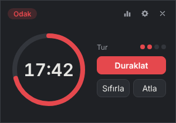

# Bölüm 10 — Odak Zamanlayıcı

Sistem tepsisinde çalışan bir Pomodoro zamanlayıcısı. Çalışma ve mola sürelerini bildirimle haber verir; penceresi kapalıyken de çalışmaya devam eder.



## Çalıştırma

```bash
npm install
npm start
```

Testler (Electron açılmadan, düz Node.js ile çalışır):

```bash
npm test
```

## Özellikler

- Odak, kısa mola ve uzun mola aşamaları; kaç odaktan sonra uzun mola verileceği ayarlanabilir
- Sistem tepsisi simgesi (odakta kırmızı, molada yeşil) ve tepsi menüsü
- Aşama bitince masaüstü bildirimi; bildirime tıklayınca sıradaki aşama başlar
- Genel klavye kısayolu: `Ctrl+Alt+P` (macOS'ta `Cmd+Alt+P`) ile her yerden başlat/duraklat
- Çerçevesiz, sürüklenebilir, isteğe bağlı her zaman üstte duran mini pencere
- Ayarlar ve günlük istatistikler JSON dosyasında (`userData` klasörü)
- Son 7 günün odak dakikalarını gösteren günlük özet
- Bilgisayar açılınca başlatma (yalnızca paketlenmiş uygulamada)
- Tek örnek kilidi: uygulama ikinci kez açılırsa mevcut pencere öne gelir
- Açık ve koyu tema (işletim sisteminin ayarını izler)

## Dosyalar

| Dosya | Süreç | Görevi |
| --- | --- | --- |
| `src/main.js` | Ana süreç | Tepsi, bildirim, kısayol, pencereler, IPC, tek örnek kilidi |
| `src/timer.js` | Ana süreç | Zamanlayıcı mantığı (`FocusTimer`), Electron'dan bağımsız |
| `src/settings.js` | Ana süreç | Varsayılan ayarlar ve doğrulama |
| `src/stats.js` | Ana süreç | Günlük odak istatistikleri |
| `src/store.js` | Ana süreç | JSON dosyası okuma/yazma |
| `src/labels.js` | Ana süreç | Tepsi menüsü ve bildirim metinleri |
| `src/preload.cjs` | Preload | `window.focusTimer` köprüsü |
| `src/renderer/` | İşleyici | Mini zamanlayıcı, ayarlar ve günlük özet sayfaları |
| `assets/` | — | Tepsi ve uygulama simgeleri |
| `test/` | — | `node:test` ile yazılmış testler |

## IPC kanalları

| Kanal | Yön | Tür |
| --- | --- | --- |
| `timer:get-state`, `settings:get`, `settings:save`, `stats:get` | işleyici → ana | `invoke` / `handle` |
| `timer:command` (`toggle`, `reset`, `skip`), `window:open`, `window:close` | işleyici → ana | `send` / `on` |
| `timer:state`, `stats:changed` | ana → işleyici | `webContents.send` |

## Notlar

- Zamanlayıcı ana süreçte çalışır; pencere yalnızca durumu gösterir.
- Kalan süre her seferinde bitiş anından hesaplanır, bu yüzden `setInterval` gecikse de süre doğru kalır.
- Ayarlar ana süreçte doğrulanır; işleyiciden gelen değerlere güvenilmez.
- Windows'ta ayarlar `%APPDATA%\Odak Zamanlayıcı\settings.json` içinde durur.

Hedef sürüm: Electron 45.
