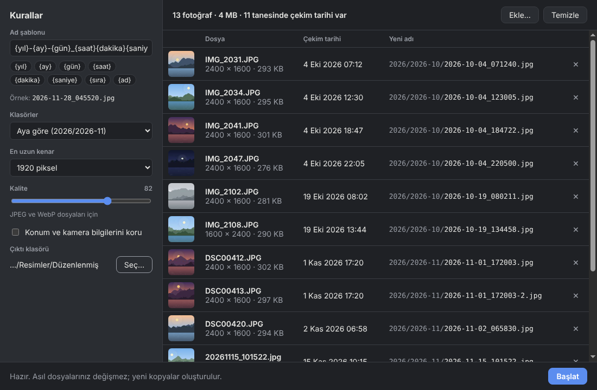

# Bölüm 11 — Toplu Fotoğraf

Sürüklenip bırakılan fotoğrafları çekim tarihine göre yeniden adlandıran, küçülten ve klasörlere ayıran bir araç. Ağır iş arka planda, ayrı bir süreçte (`utilityProcess`) yapılır; pencere hiç donmaz.



## Çalıştırma

```bash
npm install
npm start
```

Denemek için `ornekler/` klasörünü pencereye sürükleyin. Testler (Electron açılmadan, düz Node.js ile çalışır):

```bash
npm test
```

## Özellikler

- Dosya ve klasörleri sürükle-bırak ile ekleme (alt klasörler dahil) ya da "Dosya seç" diyaloğu
- Çekim tarihini EXIF'ten okuma; EXIF yoksa dosyanın değiştirilme tarihi
- Ad şablonu: `{yıl}-{ay}-{gün}_{saat}{dakika}{saniye}`, `{sıra}`, `{ad}`
- Yıla ya da aya göre klasörlere ayırma (`2026/2026-11/`)
- En uzun kenarı küçültme, JPEG/WebP kalitesi, telefonla dik çekilen fotoğrafları döndürme
- Konum ve kamera bilgilerini silme (varsayılan) ya da koruma
- Önizleme listesi: küçük resim, çekim tarihi ve yeni ad
- İlerleme çubuğu (pencerede ve görev çubuğunda), iptal düğmesi, sonuç özeti
- Asıl dosyalara dokunulmaz; her zaman yeni kopya oluşturulur, var olan dosyanın üstüne yazılmaz

## Dosyalar

| Dosya | Süreç | Görevi |
| --- | --- | --- |
| `src/main.js` | Ana süreç | Pencere, diyaloglar, IPC, işçiyi başlatma, görev çubuğu ilerlemesi |
| `src/worker.js` | İşçi (`utilityProcess`) | Tarama (EXIF, küçük resim) ve fotoğraf işleme (`sharp`) |
| `src/files.js` | İşçi | Klasör tarama, boş dosya adı bulma |
| `src/shared/plan.js` | Ana süreç + işleyici | Ad şablonu, klasörleme, çakışan adlar |
| `src/shared/labels.js` | Ana süreç + işleyici | Metinler ve şablon kelimeleri |
| `src/preload.cjs` | Preload | `window.photoTool` köprüsü |
| `src/renderer/` | İşleyici | Arayüz |
| `ornekler/` | — | Denemek için örnek fotoğraflar |
| `test/` | — | `node:test` ile yazılmış testler |

## Kullanılan npm paketleri

- [`sharp`](https://sharp.pixelplumbing.com/): görüntü küçültme, döndürme ve kaydetme
- [`exifr`](https://github.com/MikeKovarik/exifr): EXIF'ten çekim tarihini okuma

`sharp` her işletim sistemi için hazır derlenmiş dosyalarla gelir. Paketlerken bu dosyalar ASAR arşivinin dışında kalmalıdır; `package.json` içindeki `asar.unpack` ayarı bunu yapar.

Hedef sürüm: Electron 45.
