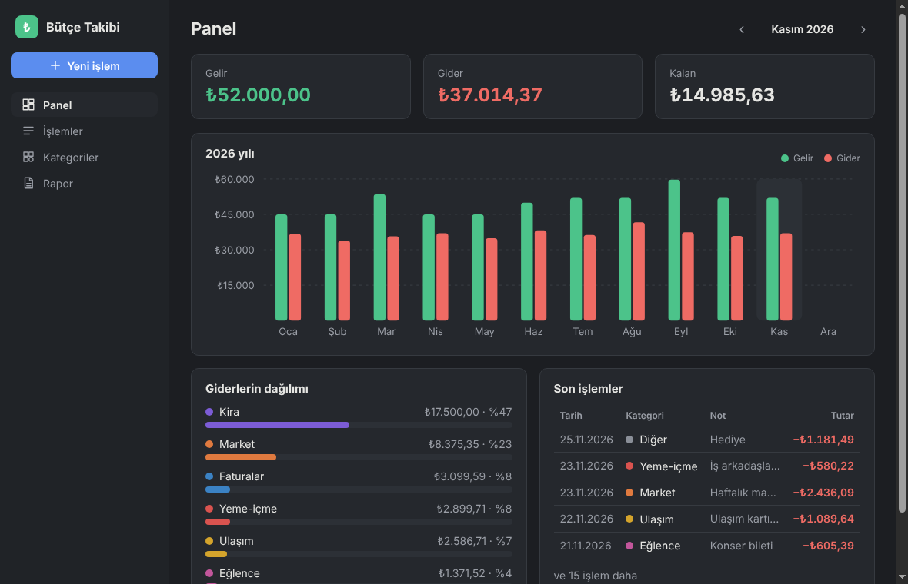

# Bölüm 12 — Bütçe Takibi

Gelir ve giderleri kategoriyle kaydeden, aylık özet ve grafik gösteren, PDF rapor ve CSV dosyası çıkaran bir bütçe uygulaması. Kitabın React ile yazılan ilk projesidir: arayüz Vite + React, veri yerel bir SQLite veritabanında.



## Çalıştırma

```bash
npm install
npm start
```

Denemek için **İşlemler > CSV içe aktar** ile `ornekler/ornek-islemler.csv` dosyasını seçin (Ocak-Kasım 2026, 236 işlem).

Testler Electron açılmadan, Vitest ile çalışır. `node:sqlite` modülü için Node.js 22.13 ya da daha yenisi gerekir:

```bash
npm test
```

## Özellikler

- Gelir ve gider ekleme, düzenleme, silme (silmeden önce onay)
- Panel: ayın gelir, gider ve kalan tutarı; yılın 12 ayı için çubuk grafik; giderlerin kategorilere dağılımı
- İşlem listesi: aya, türe ve kategoriye göre filtre, notta arama
- Kategori ekleme, yeniden adlandırma, renk seçme; işlemi olan kategori silinemez
- Aylık raporun önizlemesi ve PDF olarak kaydedilmesi (`printToPDF`)
- CSV dışa ve içe aktarma (Excel'in Türkçe biçimi: `;` ayırıcı, `1250,50` tutar)
- Veri taşıma (migration): veritabanı sürümü `PRAGMA user_version` ile izlenir
- Tutarlar kuruş olarak tam sayıyla saklanır; yuvarlama hatası olmaz
- Açık ve koyu tema

## Dosyalar

| Dosya | Süreç | Görevi |
| --- | --- | --- |
| `src/main/main.js` | Ana süreç | Başlangıç: veritabanı, IPC, pencere |
| `src/main/window.js` | Ana süreç | Pencere ayarları, sayfa yükleme |
| `src/main/database.js` | Ana süreç | Veritabanını açma, veri taşımaları |
| `src/main/budget-store.js` | Ana süreç | Bütün SQL sorguları ve doğrulama |
| `src/main/ipc.js` | Ana süreç | IPC kanalları, CSV dosya işleri |
| `src/main/report.js` | Ana süreç | Gizli pencerede PDF rapor |
| `src/preload.js` | Preload | `window.budget` köprüsü |
| `src/shared/` | Ana süreç + işleyici | Para ve tarih yardımcıları, CSV, metinler |
| `src/renderer/` | İşleyici | React arayüzü (`App.jsx`, `pages/`, `components/`) |
| `forge.config.mjs`, `vite.*.config.mjs` | — | Electron Forge ve Vite ayarları |
| `ornekler/` | — | Denemek için örnek CSV |
| `test/` | — | Vitest testleri |

## Kullanılan npm paketleri

- [`react`](https://react.dev/), `react-dom`: arayüz
- [`vite`](https://vite.dev/), [`@vitejs/plugin-react`](https://github.com/vitejs/vite-plugin-react), [`@electron-forge/plugin-vite`](https://www.electronforge.io/config/plugins/vite): derleme
- [`vitest`](https://vitest.dev/): testler

Veritabanı için ek paket yok: SQLite, Electron 45'in içindeki Node.js ile gelen `node:sqlite` modülüyle kullanılır.
